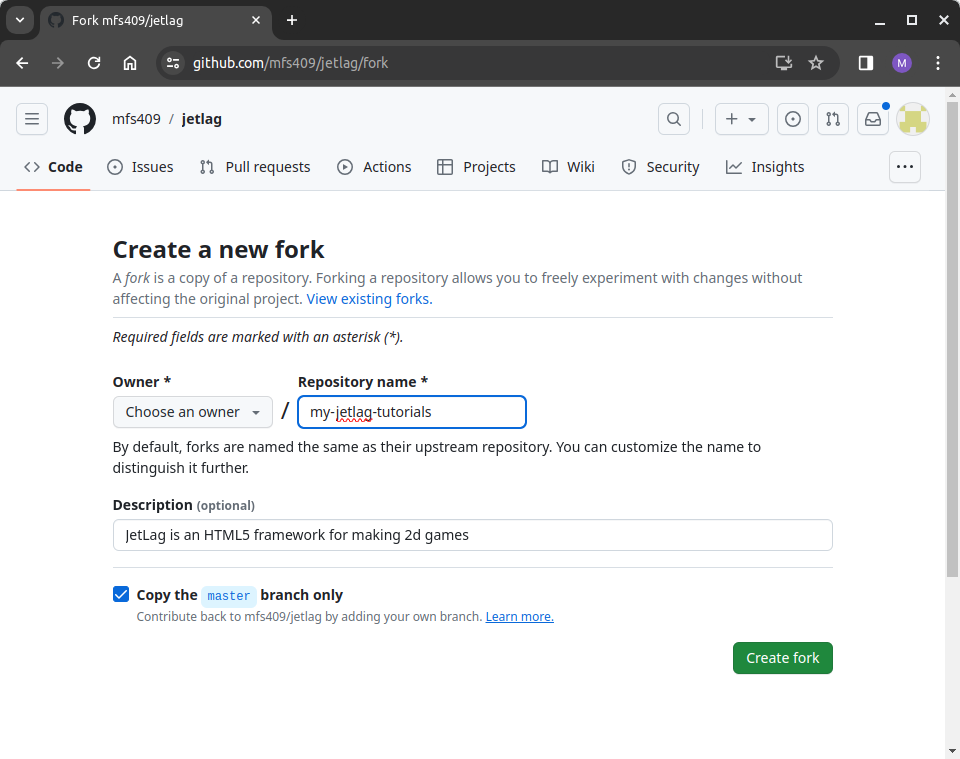

# Step 2: Getting the JetLag Code

The JetLag starter code is hosted on GitHub.
If you don't have a GitHub account, you should visit [GitHub](http://github.com) to create one.

Since you are going to be using `git` from the command line, you will need to set up "ssh keys".
These provide a secure way of interacting with GitHub.
For help, see [these instructions](https://docs.github.com/en/authentication/connecting-to-github-with-ssh/adding-a-new-ssh-key-to-your-github-account).

Once you have a GitHub account, the easiest way to get started is to "fork" the JetLag repository on GitHub.
Go to [The JetLag GitHub Page](https://github.com/mfs409/jetlag) and click the "fork" button.
You should change the name from JetLag to the name of your game (when working through this book, the name `my-jetlag-tutorials` might be a good choice).



If this all sounds strange, don't worry, it's very common.
A "git repository" is just a collection of code that is packaged up as a unit that people can work with.
When you "fork" a repository, you are essentially saying "give me a copy of the repository that I can edit."
There are two very nice aspects of forking:

- The `git` tool will give you an easy way to back up your code to the GitHub website at any time
- You can still get updates from the repository you forked.
  So whenever I update JetLag, there is a way to `git pull` from my version into yours, to get the latest features.

If this seems too confusing, then you can ignore almost all of it.
As long as you "fork" the JetLag repository, you'll have a copy of the code that you can work with, even if you never back up any of your code to GitHub.

If, on the other hand, you *want* to use `git`, but feel like you need more information, there are quite a few good tutorials online.
I'm not going to recommend one over another.
See which makes sense to you, and practice by setting up a dummy repository where you can try things out.
For what it's worth, I usually only need the `add`, `commit`, `status`, `diff`, and `push` commands, though sometimes I also need to use `checkout --` or `reset HEAD` on a file.

## Copying the Code and Running It

Now it's time to get the code from your repository onto your computer.
In `git`, this is known as "cloning".
Cloning refers to copying all the files from your repository in the cloud onto your development machine.
When you make changes to your code, they won't go to the cloud automatically.
Instead, you can periodically `commit` snapshots of your code, and then `push` them to GitHub.
This means that you can work through something tricky, and only back it up to GitHub when you're sure it's good.

Navigate to the GitHub website, go to your repositories, and click the green "Code" button.
There will be an "ssh" option, and a corresponding statement like `git@github.com:my-username/my-jetlag-tutorials.git`.
Copy that text.

Next, open a terminal and go to the place where you want to check out your code.
I'll be lazy in this section, and check out the code to my `Desktop` folder.
So from the terminal, I would type `cd Desktop` to go from my home folder into the desktop folder.
You can, of course, go to any folder that makes sense.

Now type `git clone XXX`, where `XXX` is the text that you copied from the GitHub website (in my case, I'd type `git clone git@github.com:my-username/my-jetlag-tutorials.git`).
This will take a minute to copy all the code from your fork of my repository.
It will put everything in a subfolder of the current folder (so, in my case, `Desktop/my-jetlag-tutorials`).

```terminal-mp4
./clone.mp4
Checking out a copy of your fork of the jetlag repository.  Be sure to use your username and the name of your repository.
```

To go into that folder, type `cd my-jetlag-tutorials`.
If you list the files in that folder (by typing `ls`), you'll see that the code is all there.

```terminal-mp4
./ls.mp4
Using ls to view the folder contents
```

Unfortunately, the code is not yet ready to use.
The problem is that JetLag relies on some *other* code.
If you type `npm install`, then the rest of the code that you need will be copied to your computer.

```terminal-mp4
./npm-install.mp4
Installing dependencies with npm
```

## Creating Your First Project

JetLag doesn't come with a single, fixed game for you to edit.
Instead, you can make as many separate game projects as you want, each in its own folder inside `src`.
A small tool makes the folder for you, with a starter game inside it.

To create your first project, type `npm run create`.
It will ask you for a name (letters, numbers, `_`, and `-` only), and then set up a starter game for you.
For this chapter, I recommend using the name `my_game`:

```terminal-mp4
./create-project.mp4
Creating a project
```

For now, feel free to use whatever name makes sense to you.
The book will suggest names for the different exercises in each chapter, but you can always pick something different.

## Running Your Code

To try out the code, type `npm run serve -- my_game`.
You should see something like the following:

```terminal-mp4
./run-code.mp4
Running the code, so the game can be viewed in a browser
```

There will be a line that says something like `Serving at http://localhost:7000/my_game/my_game.html`.
This means that your game is ready to try.
Open a web browser and go to the address in the "Serving at" line (so, in my case, `http://localhost:7000/my_game/my_game.html`).
You should see this:


Congratulations!
Your game is up and running.
