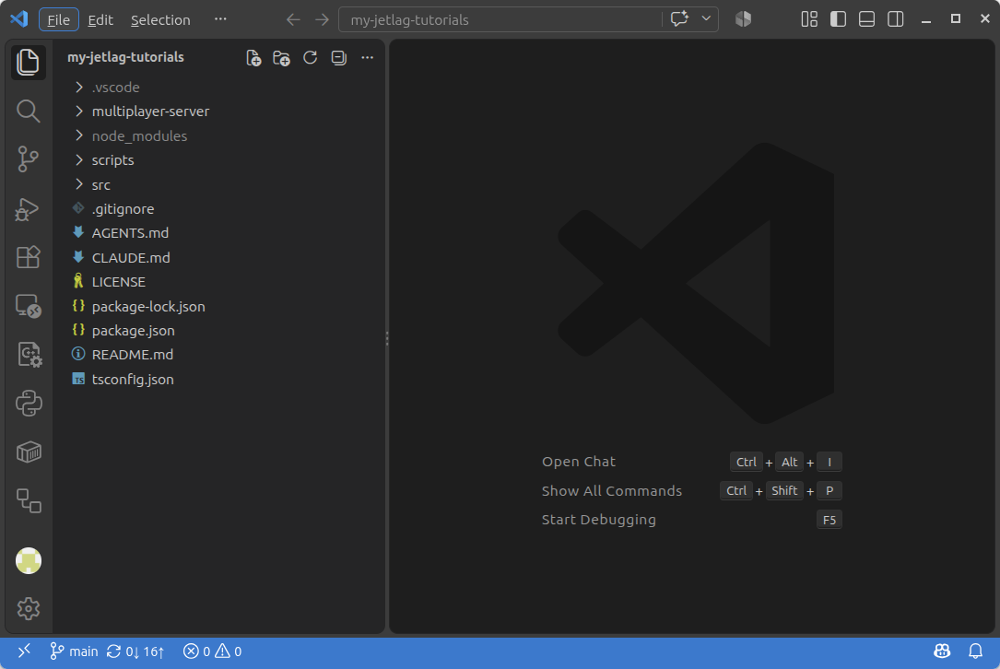

# Step 3: Navigating the Repository

Now it's time to open up the code in VSCode.
When you work in VSCode, it is useful to think about *folders*, not just *files*.
In our case, that means you will want to use VSCode to open the *folder* that is the root of your checkout.
You can either do this by opening VSCode and then going to `File/Open Folder`, or from the terminal, by going into the folder you want to view and then typing `code .` (don't forget the period!).
Either way, you should then see something like this:



```admonish Note title="Panels"
If the left side panel is collapsed, click the topmost icon in the left icon bar.
```

On the left you'll see a few files and folders:

- `.vscode` - You can ignore this.
  Sometimes, VSCode will make this folder to hold configuration information.
- `multiplayer-server` - This folder has code that you may need if you want to make a multiplayer game.
- `node_modules` - You can ignore this.
  It's where `npm` puts the things it needs in order for your game to work (that is, the stuff it downloaded when you typed `npm install`).
- `scripts` - You can ignore this.
  It's just some code for helping `npm` to know how to run your code.
- `src` - This is where all of your code goes.
  - `src/jetlag` - This is where the JetLag code can be found.
    You generally shouldn't need to edit it.
  - `src/assets` is where you should put any images, sounds, or other files that support your games.
  - `src/<my_game>` - Every other folder directly inside `src` is one of your projects, made via `npm run create`.
- `.gitignore` - This file tells `git` that some folders and files, such as `node_modules` and `.vscode`, shouldn't get backed up to GitHub.
- `AGENTS.md` - This file helps AI agents know how to help you make games.
- `CLAUDE.md` - This file is like AGENTS.md, but specifically for Claude Code.
- `LICENSE` - This file explains that you're free to use the JetLag code however you want.
- `package-lock.json` - This file is created by `npm`.
  You can ignore it.
- `package.json` - This file is used by `npm`.
  You probably won't need to work with this until your game gets very advanced.
- `README.md` - A file describing the repository.
  For now, it describes JetLag itself, but you may eventually change it.
- `tsconfig.json` - Another configuration file that you can ignore for a long time.

If that all seems confusing, don't worry.
When you're starting out, pretty much all that matters is that `npm run create` made a folder for you inside `src`, with two files inside it: an `.html` file and a `.ts` file, both named after the project you created.
Chapter 1 will show you how to start changing the code in the `.ts` file to make your own game.
