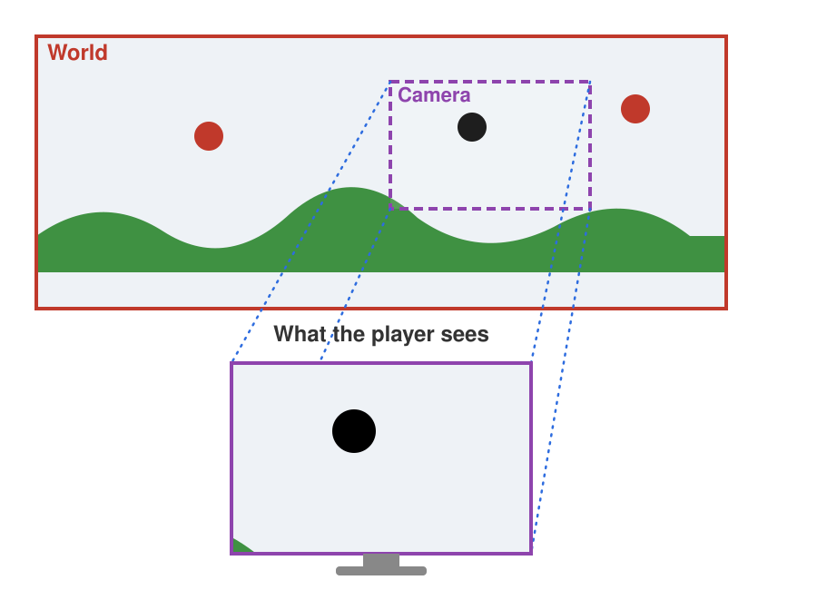
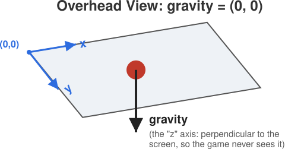
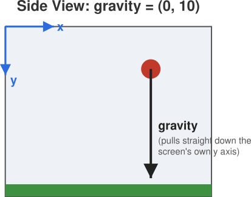

# Camera & Gravity

Camera and gravity are two completely unrelated settings in JetLag.
And yet, between them, they're responsible for most of what makes one game *feel* different from another, even when both games are built from the exact same actors.
On this page, we'll look at how the camera decides what's actually on screen, and how gravity decides which way (if any) is "down."

## The Camera: Filming the World

Box2D simulates a world that uses meters as its primary unit.
Pixi.js operates in terms of pixels.
JetLag unifies the two.
When you configure your game, you give it a default screen width and height, in meters.
JetLag inspects the browser window, figures out its dimensions, and maximizes your game by computing a pixel-per-meter ratio.
That ratio is what lets Pixi.js draw in pixels while staying compatible with Box2D underneath.
For the most part, this means you'll never need to think about pixels, only meters.

There's one more thing you need to know about that coordinate system.
Pixi.js says `(0, 0)` is the *top-left* corner of the *screen*, not the bottom-left.
X increases to the right, same as you'd expect.
But Y increases *downward*, which is the opposite of the axes you probably learned in math class.
JetLag makes the physics world follow this convention too, so downward is positive and upward is negative.
It'll feel backwards for a little while.
Then you'll stop noticing.

In many games, the world is too big to fit on the screen all at once, so only a part of it is ever displayed.
The easiest way to think about this is to imagine a camera filming your world, following the action and focusing on whatever's most important right now:



The shape with the red outline is the world.
By default, the top left of the world is (0, 0), but you can change that.
The shape with the purple outline is what the camera is currently showing.
The blue dotted lines show a projection from the world onto the camera, so only a portion of the world is visible at any one time.

You can reach the camera via `stage.world.camera`, but most of its methods aren't really there for *you* to call directly.
They exist so JetLag itself can figure out what part of your game belongs on the screen right now.
There are two exceptions you'll use whenever a world gets bigger than the screen.
You can tell the camera the minimum and maximum coordinates it's allowed to show, and you can tell it *what to follow*.
In the example, the black circle is being followed by the camera.

## Gravity Is All About Perspective

In the walkthrough that's about to come, it will *feel* like there's some kind of gravity affecting the hero, but nothing in the code will actually say so.
Let's stop and think about why.

There is gravity, it's just not pulling in the "left/right" (x) or "up/down" (y) dimensions of the screen.
It's pulling in a "z" dimension, straight down from your screen toward the center of the earth.
Put another way, the *perspective* is from above.
You're looking down at the game, so you don't expect anything to slide around the screen on its own (unless the screen itself were tilted).



In JetLag, that's a gravity of `(0, 0)`.
It's the default for every game, unless you say otherwise:

```typescript
stage.world.gravity = { x: 0, y: 10 };
```

Add that one line, and the whole perspective shifts.
It will look like you're viewing the game from the side, and the circle (with nothing under it) falls straight down, off the bottom of the screen.
For now, it will fall forever, because there's no floor yet to catch it.



## Putting Them Together

Camera and gravity are independent settings, but combining them is what actually produces a game's *feel*.
The same handful of actors, with only the camera's framing and gravity's direction changed, can feel like an overhead maze, a side-view platformer, or a top-down shooter.
Later in this section, you'll find four small games that set up the camera and gravity to get different feels.
Play them, and see if you can name the choice before you look at the code.
But first, let's look at a little bit of code, so you can start to see how changing the program changes the game.
