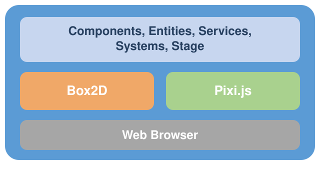
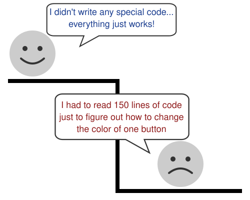

# Implementing the Simulation

Here's something you might find surprising: JetLag is only around 4,000 lines of code.
In the grand scheme of things, that's not very much.
How can it have a full physics simulator, a full graphics system, a gesture interface, sounds, filters, and more?

The truth is that JetLag mostly just stitches together other pieces of software, and wraps them in a clean interface (sometimes called an API).
Almost no software is built from scratch.
When someone writes code and shares it, expecting other people to *use* it (without modifying it), that code is called a **library**.

JetLag relies heavily on two libraries.
**[Box2D](https://box2d.org/)** is an industrial-strength physics simulator.
JetLag gives it shapes, puts them into a "world," and lets it run a simulation where those shapes move and collide.
**[Pixi.js](https://pixijs.com/)** draws 2D images.
It doesn't know anything about physics, and Box2D doesn't know anything about drawing, but they agree on the same basic shapes (circles, rectangles, polygons).

Both are general-purpose libraries.
They're useful for plenty of things besides games.
JetLag's whole job is to give you a game-specific interface to both of them.
You get easier building blocks than working with Box2D and Pixi.js directly.
Every so often, though, you may need to reach down into them to harness their full power.
When that happens, their online documentation should have what you need.

Here's a rough sketch of how it all fits together:

At the top, JetLag provides Components, Entities, Services, Systems, and a Stage.
They're built on Box2D and Pixi.js, in the middle.
JetLag hides just enough of those two that getting started isn't overwhelming.
At the bottom, Pixi.js and Box2D talk to a web browser, which displays the game and receives input.

One thing makes JetLag different from most libraries: it expects every game to eventually customize it.
When you make a game with JetLag, you copy JetLag's own code into your project, right next to the code you write.
That's different from using `npm` to fetch the code into a location that you're not supposed to change.
JetLag is designed this way so that when your game needs more of Box2D or Pixi.js's power, you can change JetLag itself to expose that power.
Your code can grow gradually into more of what Box2D and Pixi.js can do, instead of falling off a cliff:

One more thing, before looking at any code: if "my game runs in a web browser" doesn't sound like what you want, JetLag is still a reasonable choice.
A later chapter covers [Capacitor](https://capacitorjs.com/) and [Electron](https://www.electronjs.org/), which wrap a JetLag game as a mobile or desktop app.
