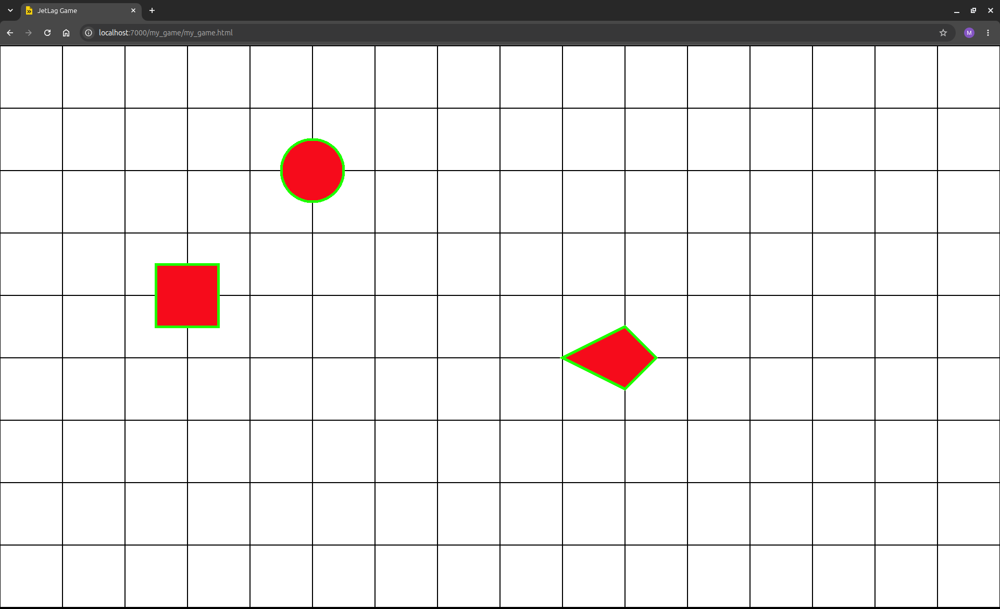
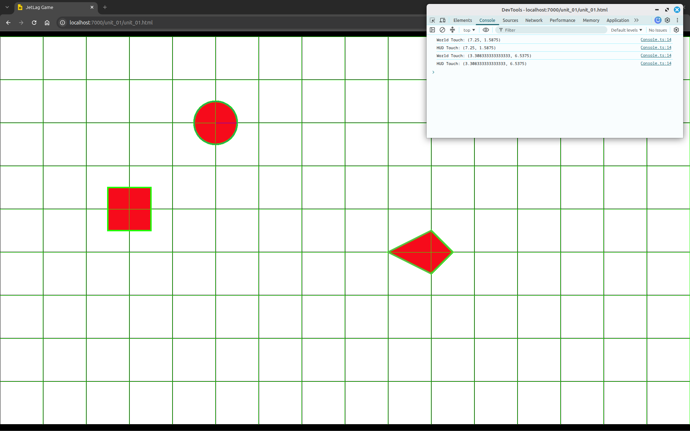

# Understanding the Default Game

Since you've already got a copy of JetLag, it's time to take a look at some game code.
You'll need to open up a terminal and create a new game.
To do this, run `npm run create` and when asked for a name, enter `unit_01`.

```terminal-mp4
./create-project.mp4
Creating a new project
```

That last line explains how to run the game.
If you type `npm run serve -- unit_01`, you should see something like this:

```terminal-mp4
./run-project.mp4
Running the project
```

If you open up your web browser and go to `http://localhost:7000/unit_01/unit_01.html`, you should see this game, where the arrow keys control the movement of the circle:



There are two files that are working together to make this simple game.
Let's explore them one-by-one.

## The HTML File

The starter game is based on two files: a `.ts` file of code, and a matching `.html` file that tells a web browser how to display the code.
Let's understand what's in them, starting with the `unit_01.html` file:

```html
{{#include ./unit_01.html}}
```

```admonish Note
Most of this file is not going to change very much from one game to the next.
If you don't understand all the details, that's okay.
```

This is a basic HTML file.
Its job is to describe a web page: its shape, its style, and where to find its code.
In most cases, you'll want the game to fill the whole browser window, so that's what the HTML file sets up.

The `head` section describes the general appearance of the web page.
Within it, the `meta` tags tell mobile browsers how to stretch the page to fit a small screen (just in case you're targeting mobile devices).
The `style` tag makes the page fill the screen.
The `title` is what appears in the browser tab.
The first thing you should do when you start a new game is update the title.

The `body` has two parts.
The `div`, which by default is named `game-player`, is where the game will appear.
The name matters, and you'll see why in a moment.
Then comes the `script` tag, which says that in this case the code to run is called `unit_01.js`.
You probably don't want to change anything in the `body`.

## The TypeScript Code

Now take a look at `unit_01.ts`.
Notice that its name is *not* `unit_01.js`.
It has a `.ts` extension, but the HTML file expects a file with a `.js` extension.
The `.ts` file only has the code you write, none of the JetLag/Pixi.js/Box2D code underneath it.
When you run `npm run serve -- <name>`, your `.ts` file gets combined with several libraries to produce the `unit_01.js` file the HTML page expects.

```admonish Note title="Developer vs deployment builds"
`npm run serve -- <name>` is the command to use while working on your game.
It builds a version of your game for the browser, and rebuilds it every time you save.
`npm run check` looks for errors in your code without building anything, and `npm run build -- <name>` produces a standalone, deployable version once you're ready to share it.
You don't need to worry about any of this for now.
It will be discussed in more detail in a later chapter.
```

### The Main Parts Of The File

There are four important parts of a `.ts` file.
First, the `import` statement(s) at the top say which parts of JetLag your game needs.
For now they're all on one line.
Later, you'll learn how to get VSCode to manage them automatically as you use new features.

```typescript
{{#include ../../tssrc/01/default_game.ts:1}}
```

Second, the `Config` class tells JetLag the width and height of your game (in meters) and whether it should draw "hit boxes" around things.
Leave that `true` while developing.
You can set it to `false` once you're confident everything's right.

```typescript
{{#include ../../tssrc/01/default_game.ts:3:13}}
```

This class `implements` something called `JetLagGameConfig`, which means that if you forget a required field, you will get an error.
Try it: put `//` in front of `hitBoxes = true;` and watch what happens: `Config` gets a red underline, and hovering over it shows you exactly what's missing.

As you make progress, you'll discover plenty of optional fields you can add to this class, such as the names of fonts, images, and sound files.
Don't worry about them yet.

Third comes a function that describes how to set up a stage.
In this example, it's called `builder`.
A game's code can get long, at which point you'll want to break it up into several functions, and maybe even several files.
For now you're going to put all your code in one function, in one file.
`builder` sets up the *initial state* of the game.
It runs to completion before you get to play, and everything that happens afterward is because of the physics simulator or an event.

```typescript
{{#include ../../tssrc/01/default_game.ts:15:63}}
```

Last, there is a single-line call to `initializeAndLaunch`, which is what actually starts your game running.
It includes the name of your `builder`, and also a new instance of your `Config` object, so that JetLag knows how to set up the browser and how to set up the stage.
Notice the `div` name from the HTML file appears here too.
That's essential.
It lets JetLag find a specific `div` in your HTML file and put the game inside it.

```typescript
{{#include ../../tssrc/01/default_game.ts:67}}
```

Before looking more deeply at `builder`, I want you to notice one important thing.
The code has many comments.
That's not an accident.
You should make sure to explain your code as you write it.
It's common when making a game that you'll write something tricky, leave it alone for a week, and then need to come back to it.
The comments are for you, so your future self knows what your past self did.

### Breaking Down the Builder

JetLag uses an entities-and-components model: every actor is an "Entity," with "Components" attached to it that give it appearance and behavior.
Looking inside the `builder` function, you'll find a few different ways that these actors are made and used.

#### Helpful Stuff for Beginners

The first line you'll see is:

```typescript
{{#include ../../tssrc/01/default_game.ts:26}}
```

The first line draws a grid on screen.
Open your browser's developer console (F-12, then "Console") and click anywhere on the screen, and you should see the coordinates of your click reported:



("World Touch" and "HUD Touch" are the same for now.
A later chapter gets into the difference, so ignore "HUD Touch" until then.)

The grid is made of actors, but they are more like props: they don't move, and they don't collide with anything.
The grid is just there to help you get oriented, so I won't dwell on it.
More interesting is how the world relates to `Config`: you asked for a 16x9-meter screen, and JetLag is figuring out how large it can stretch that world without distorting it.
If you resize your browser, the game stays 16x9 (with black bars added as needed).
No matter the window size, a game always shows a simulated world that's 16x9 meters if those are the dimensions in your `Config`.

The next line is:

```typescript
{{#include ../../tssrc/01/default_game.ts:30}}
```

This line makes it so that pressing the `b` key toggles debug boxes.
When you're developing, and `hitBoxes = true` in your config, it can be useful to turn the hit boxes on and off in the middle of a test.

```admonish Note
When you're ready to share your game with others, you'll probably want to remove the grid and the `DebugToggle`, and to set `hitBoxes = false`.
But when you're just getting started, they can be quite helpful.
```

#### The Hero

Actors are the main kind of entity.
Every actor needs an `appearance` and a `rigidBody`.
Other components are optional.

```typescript
{{#include ../../tssrc/01/default_game.ts:32:38}}
```

This actor is saved to a variable, `hero`, so later code can find it again.
Its appearance is a circle with radius 0.5 meters (so, width and height of 1), colored red, with a wide green border.
Its body is also a circle of radius 0.5.
Appearance and body don't have to match, but here they do.
`cx`/`cy` are the center point of the actor.
Remember that (0, 0) is the world's top-left corner, with X increasing rightward and Y increasing downward.

The hero has a `DynamicBodyMovement` object to control its movement.
This is the default for things that you'll want to control.
It doesn't actually establish any rules for making the actor move.
Instead, it (1) ensures the actor isn't hard-coded as stationary, (2) ensures that every collision between this actor and other actors will be detected, and (3) makes the actor experience gravity.

The hero's `behaviors` field holds a `PlayerControlBehavior`.
On its own, that doesn't make the hero move (the keyboard handlers below do that).
It's mostly a marker saying "this is the actor the player controls," which other parts of the engine can check for later.
It also makes the hero take part in collisions.

```admonish Note
You can leave out the `movement` line, and the game will play exactly the same.
JetLag notices the problem, fixes it for you, and writes a warning to the browser's console.
You can't leave out `behaviors`.
Without it, the hero gets a `PassiveBehavior`, and passive actors pass right through the obstacles.
It's better to be explicit about both.
Otherwise, when your game gets more complex, it will be difficult to figure out why something isn't behaving correctly.
```

#### The Obstacles

There are two actors who don't have a `movement` and can't move on their own.
They are configured with the same code pattern, but aren't saved to variables, since nothing else needs to refer to them later.
One's a box, one's a polygon.

```typescript
{{#include ../../tssrc/01/default_game.ts:40:45}}

{{#include ../../tssrc/01/default_game.ts:47:52}}
```

Boxes just need a width and height.
The polygon is trickier: polygons must be convex, and you define them with the (x, y) coordinates of their vertices, in clockwise order, relative to the polygon's center.
Here, that's (0, -.5), (.5, 0), (0, .5), and (-1, 0) for the left, top, right, and bottom vertices.

```admonish Note
The easiest way to get comfortable with polygons is to change some numbers and see what happens.
You'll use plenty of polygons once you're building a real game, but you can wait until then to get comfortable with the details.
```

Both obstacles have a `SolidBehavior`, which is the most natural kind of physical actor: other actors simply can't pass through them, with no collision code written by you at all.
(The grid's lines have no `behaviors` at all, so they default to `PassiveBehavior`, and don't collide with anything.)

The appearance is bland right now, since it's just solid shapes.
A later chapter shows how to use pictures and animations instead.

#### Events

As written, nothing would happen.
The world would just sit there.
The last part of the code lets the player control the hero, through events.

```typescript
{{#include ../../tssrc/01/default_game.ts:54:62}}
```

This code handles two kinds of events: keyboard key-down and key-up.
Hover over `setKeyUpHandler` in VSCode and you'll see pop-up help.
In fact, you can hover over almost *anything* in the code and get help.
Here, it says the code is what should run whenever a given key is released.

TypeScript lets you write functions inline, with `()=>{}` (or `()=>body`, when the `body` is one line).
So this is eight handler registrations covering up and down for the four arrow keys and the four `WASD` keys.
Using an array (`[]`) makes it easy to assign the same behavior to several keys at once.

Each handler updates the hero's velocity directly, by operating on its `rigidBody`.
Pressing a key makes part of the velocity nonzero, and releasing it sets that part back to zero.
You should be able to press two directions simultaneously, like `Up` and `Left`.

#### The Stage

One thing I glossed over above is the "stage."
Think of it as an Entity, but a special one.
There's only one stage, and it has features actors don't, like being the only thing that understands keyboard events, via `stage.keyboard`.
A later chapter explores this further.

### The Playable Game

Below is a playable version of this game.
Click it, then use the arrow keys.
The hero should move and collide with the obstacles.
Be sure to press `b` to toggle the hit boxes.
You should try opening the developer console too (typically by pressing `F-12`) to see click coordinates as you go.

<iframe src="./default_game.html"></iframe>

If you've been following along in your own project, this is a good time to experiment.
Change actor positions or dimensions, change an `appearance` to differ from its `rigidBody`, or maybe adjust the keyboard velocities.

If you're feeling more daring, try to change the `vertices` of the polygon.
Maybe even try to make a concave polygon, and notice how the `appearance` works fine, but the `rigidBody` misbehaves.
