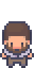

# Welcome



Hi, I'm Professor Parse, and I made this book as a way to help you learn how to make video games.

I believe that the best way to learn is by doing, so right from the start, you're going to see real code, and real (but small) games.

In the first chapter, you'll see four tiny games, then you'll build a simple game where you need to collect fireflies and put them in a jar before sunrise.
In later chapters, you'll make a mini-golf course with a windmill that swats your ball away, a penguin who sneaks past seals to steal a fish, two robots who have to hold doors open for each other, a pirate hunting for buried treasure, an arena full of slimes that multiply when you're not looking, a haunted house where the lights go out halfway through, and more.
Each game is small enough to finish in a day, and fun enough to show your friends.
And each one is built around one big idea about how games work, so by the time you're done, you'll be ready to make the games *you* want to make.

## This Book Is For Everyone

If you're new to game development, and especially if you're new to programming, I want you to know that everything in this book is meant to make sense even if this is your first time writing code.
Along the way, you'll learn a lot about programming, and even some core computer science concepts.
I won't cover everything you'd learn in a first college course, but by the time you reach the end of this book you'll be very well prepared to learn more, learn on your own, and do well in future projects.
You'll also learn how to work alongside AI coding assistants, and you'll build an understanding of when they're helpful and when they're not.

If you're an experienced programmer, you might think that the small game examples in this book mean that you won't learn how to make anything **big**.
That's not true.
The game engine we use, [JetLag](https://github.com/mfs409/jetlag), is designed to be beginner-friendly, but it has been used to make substantial games in many different styles.
It has been under development, in various forms, since 2012.
It uses Box2D and Pixi.js under the hood, so it's got a lot of power, and it doesn't hide that power from you.
Of course, there are things about JetLag that won't work for making a triple-A game.
But even if that's your goal, I bet you'll learn a lot from this book.

## Play As You Read

This book is designed to be read in a browser on a laptop or desktop computer, because everything you learn comes with real, playable games, not just code snippets.
Here's the game you'll build in Chapter 1.
Use the arrow keys to catch ten fireflies, then get to the jar before the sun comes up:

<iframe src="./01/mbe_firefly_jar_game.html"></iframe>

It's a complete game, with a goal, a clock, and a way to win or lose, and it's built from the same handful of pieces that every game in this book starts from.
By the end of Chapter 1, you'll have built it yourself.
More importantly, you'll understand how it works, so you can start building your own games.

## When You Get Stuck

You will get stuck sometimes.
Everyone does.
It's part of making games, and honestly, some of the best learning happens when something doesn't work, and you figure out why.
It feels great when you fix a bug and then see your idea playing on the screen in front of you.

So when you hit a wall, keep at it.
And if you can't get past it, reach out.
Also, I'm sure that I've made mistakes in this book.
A chapter might assume you know something you haven't learned yet, or explain something less clearly than it should.
Whether you think the problem is yours or mine, the best place to ask is the [JetLag Issue Tracker](https://github.com/mfs409/jetlag/issues).

```admonish warning title="No Phones"
Note that you'll need a Windows, Mac, or Linux computer to work through this book.
A Chromebook or phone won't be enough.
Even if your goal is to use this book to make a game that works on a phone, you'll still need a computer to write that game.
```

## Credits & Licenses

This book's demos rely on a few assets that I didn't make:

**Fonts.** The `Arimo` and `Roboto` fonts used throughout this book's demos are from Google Fonts.
Arimo is licensed under the [SIL Open Font License, Version 1.1](https://openfontlicense.org/).
Roboto is licensed under the [Apache License, Version 2.0](https://www.apache.org/licenses/LICENSE-2.0).

**The lizard, pirate, and alien characters.** These were generated with the [Universal LPC Sprite Sheet Character Generator](https://sanderfrenken.github.io/Universal-LPC-Spritesheet-Character-Generator/).
That generator combines artwork from many contributors to the Liberated Pixel Cup and OpenGameArt.org, each piece licensed CC-BY-SA 3.0 and/or GPL 2.0/3.0 (see [opengameart.org](https://opengameart.org/) for the specific terms of each).
The combined artwork used in this book's three generated characters is credited to: bluecarrot16, Benjamin K. Smith (BenCreating), Evert, Eliza Wyatt (ElizaWy), TheraHedwig, MuffinElZangano, Durrani, Johannes Sjölund (wulax), Stephen Challener (Redshrike), Nila122, Matthew Krohn (makrohn), Zi Ye, Mark Weyer, David Conway Jr. (JaidynReiman), Carlo Enrico Victoria (Nemisys), Fabzy, and Pierre Vigier (with the DCSS artists credited [here](https://github.com/crawl/tiles/blob/master/ARTISTS.md)).

**Professor Parse.** My own portrait throughout this book was generated with the [Modern Interiors](https://limezu.itch.io/moderninteriors) character generator by [LimeZu](https://limezu.itch.io/).
