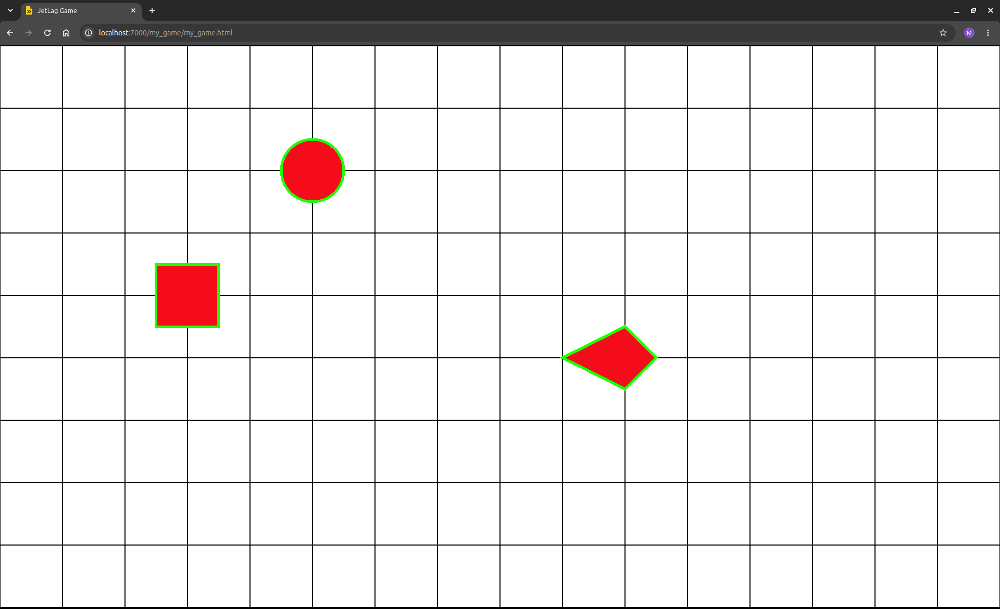
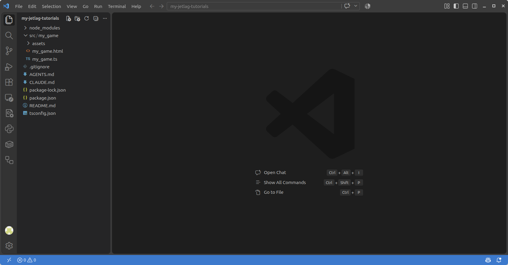

# Setting Up Your Computer

Getting started with JetLag means installing and configuring some software on your computer.
There's no programming here.
This is just about getting your computer set up, and getting a copy of the JetLag code that you can actually run.
Once you've set it up, you will be able to do all of the chapters of this book in that one copy of the code.
You can also make your own games from that copy.

Before you begin, please keep in mind that Windows, macOS, and Linux have different setup steps, and the steps might change every few months.
Please treat this section as an informal guide, and be ready for small differences between what it says and what works on your computer.

## Step 1: Installing Some Free Software

You will need the following programs in order to work with JetLag:

- A terminal:
  - Every major operating system has at least one terminal program (some even have more than one).
    It should not matter which terminal you use.
- Node.js (`node`) and the Node Package Manager (`npm`):
  - JetLag uses `node` and `npm` to transform your code into a format that can be run inside a browser.
    You probably want to use the "LTS" version of node.js.
- A web browser:
  - Any modern browser will do.
    JetLag has been tested on Chrome, Edge, and Firefox.
- An editor:
  - Strictly speaking, you can use any program that can edit text.
    However, since JetLag uses the TypeScript programming language, you will probably find that Visual Studio Code ("VSCode") offers many benefits and makes your experience much nicer.

Below are links to tutorials for helping you to install these programs.

- Windows Instructions
    - [Visual Studio Code](https://code.visualstudio.com/docs/setup/windows)
    - [Node.js and NPM](https://www.geeksforgeeks.org/installation-of-node-js-on-windows/)

- MacOS Instructions
    - [Visual Studio Code](https://code.visualstudio.com/docs/setup/mac)
    - [Node.js and NPM](https://nodejs.org/en/download/package-manager#macos)

- Linux Instructions
    - [Visual Studio Code](https://code.visualstudio.com/docs/setup/linux)
    - [Node.js and NPM](https://nodejs.org/en/download/package-manager#debian-and-ubuntu-based-linux-distributions)

### Verifying That The Software Works

After you've installed `VSCode`, `node.js`, and `npm`, follow these steps to make sure they're working correctly:

- Open a terminal
- Type `node --version` and press `<enter>`.
- Type `npm --version` and press `<enter>`.
- Type `code --version` and press `<enter>`.

The output in your terminal should look something like this:

```terminal-mp4
./media/version-check.mp4
Checking the versions of node, npm, and code should return valid version numbers, not errors.
```

### Configuring Visual Studio Code (Optional)

I recommend doing a little bit of configuration in VSCode.
You can get to the settings in VSCode by pressing `F1`, typing `settings` into the search box, and then choosing "Open Settings (UI)".

- Using the search bar, find "Editor: **Format On Save**" and set it to true.
- Then find "Typescript > Format: **Enable**" and be sure to check it.

## Step 2: Getting the JetLag Code

When you installed `npm`, a program called `npx` was also installed.
You can use this program to run the initialization script for setting up your JetLag project.
In the example below, I opened a terminal in my `Desktop` folder.
(You might need to type `cd ~/Desktop` in the terminal to get to the right folder).
Then I typed `npx jetlag2d init my-jetlag-tutorials`.
This created a new JetLag project with the name `my-jetlag-tutorials`:

```terminal-mp4
./media/get-code.mp4
Creating a project folder for making games with JetLag
```

The new project is in the `my-jetlag-tutorials` subfolder of your `Desktop` folder.
To go into that folder, type `cd my-jetlag-tutorials`.
If you list the files in that folder (by typing `ls`), you'll see that there's an empty JetLag project:

```terminal-mp4
./media/show-files.mp4
Showing the contents of the project folder
```

Unfortunately, the code is not yet ready to use.
The problem is that JetLag relies on some *other* code.
If you type `npm install`, then the rest of the code that you need will be copied to your computer.

```terminal-mp4
./media/install-deps.mp4
Installing dependencies in the project folder
```

You can make many games inside this folder.
Each will be its own subfolder of the `src` folder.
To set up a game, you can type `npm run create XXX`, where `XXX` is the name of the folder for your new game.
That name shouldn't have spaces in it.
For example, to create a game called `my_game`, you would type `npm run create my_game`:

```terminal-mp4
./media/create-project.mp4
Creating a game called 'my_game' within the project folder
```

In each chapter, I'll suggest a name for you to use.
That name is important, because you use it to decide which game to run, or to package up to share with others.

Testing out your game takes two steps.
First, you'll need to start a web server that runs it.
Then you can open it in your browser.
To run the game called `my_game`, you'd type `npm run serve my_game`:

```terminal-mp4
./media/run-server.mp4
Starting a server so the game can be played in a browser
```

In that example, I pressed `ctrl-c` right away.
(That means I held down the `ctrl` key and pressed `c`.)
Pressing `ctrl-c` stops the server.
You don't want to do that yet, because you need the server to run, so that you can visit your game from a web browser.

You should see a line that says something like `Serving at http://localhost:7000/my_game/my_game.html`.
That is the address for testing your game.
Open a web browser and go to the address in the "Serving at" line (so, in my case, `http://localhost:7000/my_game/my_game.html`).
You should see this:



Congratulations!
Your game is up and running.

That address only works on your computer.
Later, you'll learn how to make your game accessible to other people.

One last thing: you should only press `ctrl-c` when you're done working on your game for a while.
Otherwise you should leave it running.
When you make changes to your code, the server will detect the changes automatically, re-build your game, re-serve it, and refresh your browser.
This helps you to be productive.
Of course, right now we're not going to keep playing this very dull game.
So go back to your terminal and press `ctrl-c` to stop the server.

## Step 3: Navigating the Repository

Now it's time to open up the code in VSCode.
When you work in VSCode, it is useful to think about *folders*, not just *files*.
In our case, that means you will want to use VSCode to open the *folder* that is the root of your checkout.
You can either do this by opening VSCode and then going to `File/Open Folder`, or from the terminal, by going into the folder you want to view and then typing `code .` (don't forget the space and period!).
Either way, you should then see something like this:



```admonish Note title="Panels"
If the left side panel is collapsed, click the topmost icon in the left icon bar to open it.
If there's a right-side panel, feel free to close it.
```

On the left you'll see a few files and folders:

- `.vscode` - If it's there, ignore it.
  Sometimes VSCode will make this folder to hold configuration information.
- `node_modules` - You can ignore this too.
  It's where `npm` puts the things it needs in order for your game to work (that is, the stuff it downloaded when you typed `npm install`).
- `src` - This is where all of your code goes.
  - `src/my_game` - The folder that holds the game you made via `npm run create my_game`.
    Inside it, you'll find three things:
    - `src/my_game/assets` - An empty folder where you'll put any fonts, images, sounds, or other media files that `my_game` uses.
    - `src/my_game/my_game.html` - The web page that uses the code from `my_game.ts`.
    - `src/my_game/my_game.ts` - The code for the game called `my_game`.
- `.gitignore` - If you're using `git` to manage your source code, this tells it which files not to manage.
  You can ignore it.
- `AGENTS.md` - This file helps AI agents know how to help you make games.
- `CLAUDE.md` - This file is like AGENTS.md, but specifically for Claude Code.
- `package-lock.json` - This file is created by `npm`.
  You can ignore it.
- `package.json` - This file is used by `npm`.
  You probably won't need to work with this until your game gets very advanced.
  It told `npm` which libraries to fetch when you typed `npm install`
- `README.md` - A file describing the project.
  It has some useful info about how to build and run your games.
- `tsconfig.json` - Another configuration file that you can ignore.

If that all seems confusing, don't worry.
When you're starting out, pretty much all that matters is that `npm run create` made a folder for you inside `src`, with two files inside it: an `.html` file and a `.ts` file, both named after the project you created.
Chapter 1 will show you how to start changing the code in the `.ts` file to make your own game.
