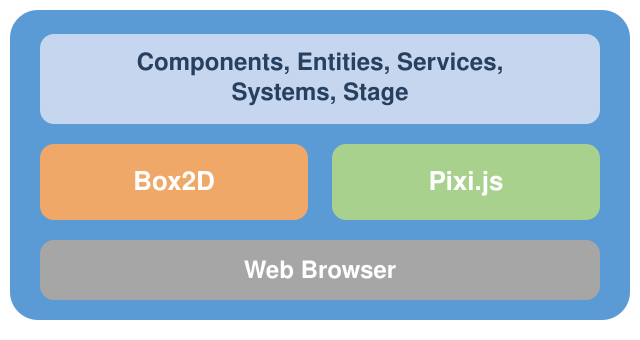
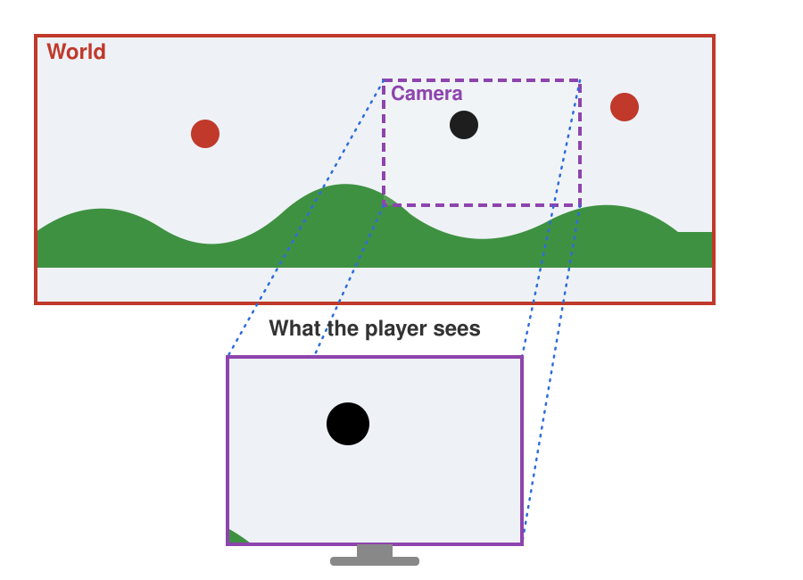
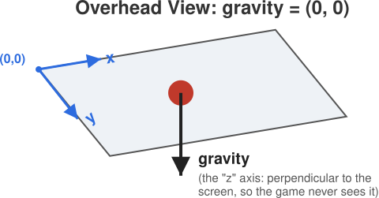
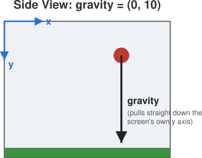

# Building A Mental Model

JetLag organizes games around the metaphor of a theater production.
There's a **stage**, where all the action happens.
It's the place where some fictional "world" comes to life.
On that stage are **actors**: the things that make the game fun to play, the same way actors make a play entertaining to watch.
There are usually some props, too, but the line between an actor and a prop turns out to be pretty blurry, so JetLag just calls everything an actor.

Each level of your game is like an act or scene of the play.
When a level starts, some actors are pre-positioned on the stage, already doing whatever the script says they should do.
Then events happen, which drive the action forward.

In a play, you take for granted that the laws of nature apply.
People can't fly around stage without wires.
Whispers can't be heard in the back of the theater without microphones and speakers.
Similarly, in a game, the physics simulator sets up the "laws of nature."
Every actor is bound by the laws of the physics simulator at all times.
If an actor is configured to be stationary, it won't move.
If it's configured to fall from the sky, subject to some gravitational force, that's exactly what it will do.

If that's all there were, the game wouldn't be very fun.
It would play out the exact same way every time, ignoring whatever the person playing it is trying to do.
**Events** are how you interrupt the simulation and change it.
When an event happens, you (as the programmer) have the ability to provide code that runs *instead of* or *in addition to* what the physics simulator says should happen.

JetLag has four kinds of events:

- **Collisions**: When two actors touch, that's a chance to run code
- **Timers**: You can ask for some code to run after some time passes
- **User input**: You can run code in response to taps, clicks, keyboard presses, and other gestures
- **Network input**: You can run code in response to network messages, such as updates from other players in a multiplayer game

The code you write, which runs in response to an event, is sometimes called a "script", an "event handler", or a "callback".
It's OK to use these names interchangeably.
They all mean the same thing: code that changes the state of the physics simulation in response to an event.

There's a surprising consequence to this way of thinking.
A game is nothing more than a physics simulation you can interact with.
The player is just an audience member who gets to change what happens in the play.

## Implementing The Simulation

Almost no software is built from scratch.
When someone writes code and shares it, expecting other people to *use* it (without modifying it), that code is called a **library**.

JetLag is a library.
It also relies heavily on two other libraries.
**[Box2D](https://box2d.org/)** is an industrial-strength physics simulator.
JetLag uses it to define shapes in a "world."
Then it runs the simulation where those shapes move and collide.
**[Pixi.js](https://pixijs.com/)** draws 2D images.
It doesn't know anything about physics, and Box2D doesn't know anything about drawing, but they agree on the same basic shapes (circles, rectangles, polygons).

Box2D and Pixi.js are general-purpose libraries.
They're useful for plenty of things besides games.
JetLag's whole job is to give you a game-specific interface to both of them.
The interface gives you building blocks that are easier than working with Box2D and Pixi.js directly.
Every so often, though, you may need to reach down into them to Box2D or Pixi.js to harness their full power.
When that happens, their online documentation should have what you need.

Here's a rough sketch of how it all fits together:



At the top, JetLag provides Components, Entities, Services, Systems, and a Stage.
They're built on Box2D and Pixi.js, in the middle.
JetLag hides just enough of those two that getting started isn't overwhelming.
At the bottom, Pixi.js and Box2D talk to a web browser, which displays the game and receives input.

One more thing, before looking at any code: if "my game runs in a web browser" doesn't sound like what you want, JetLag is still a reasonable choice.
A later chapter covers [Capacitor](https://capacitorjs.com/) and [Electron](https://www.electronjs.org/), which wrap a JetLag game as a mobile or desktop app.

## Camera & Gravity

Camera and gravity are two completely unrelated settings in JetLag.
And yet, between them, they're responsible for most of what makes one game *feel* different from another, even when both games are built from the exact same actors.
Let's look at how the camera decides what's actually on screen, and how gravity decides which way (if any) is "down."

### The Camera: Filming the World

Box2D simulates a world that uses meters as its primary unit.
Pixi.js operates in terms of pixels.
JetLag unifies the two.
When you configure your game, you give it a default screen width and height, in meters.
JetLag inspects the browser window, figures out its dimensions, and maximizes your game by computing a pixel-per-meter ratio.
That ratio is what lets Pixi.js draw in pixels while staying compatible with Box2D underneath.
For the most part, this means you'll never need to think about pixels, only meters.

There's one more thing you need to know about that coordinate system.
Pixi.js says `(0, 0)` is the *top-left* corner of the *screen*, not the bottom-left.
X increases to the right, same as you'd expect.
But Y increases *downward*, which is the opposite of the axes you probably learned in math class.
JetLag makes the physics world follow this convention too, so downward is positive and upward is negative.
It'll feel backwards for a little while.
Then you'll stop noticing.

In many games, the world is too big to fit on the screen all at once, so only a part of it is ever displayed.
The easiest way to think about this is to imagine a camera filming your world, following the action and focusing on whatever's most important right now:



The shape with the red outline is the world.
By default, the top left of the world is (0, 0), but you can change that.
The shape with the purple outline is what the camera is currently showing.
The blue dotted lines show a projection from the world onto the camera, so only a portion of the world is visible at any one time.

You can reach the camera via `stage.world.camera`, but most of its methods aren't really there for *you* to call directly.
They exist so JetLag itself can figure out what part of your game belongs on the screen right now.
There are two exceptions you'll use whenever a world gets bigger than the screen.
You can tell the camera the minimum and maximum coordinates it's allowed to show, and you can tell it *what to follow*.
In the example, the black circle is being followed by the camera.

### Gravity Is All About Perspective

In the walkthrough that's about to come, it will *feel* like there's some kind of gravity affecting the hero, but nothing in the code will actually say so.
Let's stop and think about why.

There is gravity, it's just not pulling in the "left/right" (x) or "up/down" (y) dimensions of the screen.
It's pulling in a "z" dimension, straight down from your screen toward the center of the earth.
Put another way, the *perspective* is from above.
You're looking down at the game, so you don't expect anything to slide around the screen on its own (unless the screen itself were tilted).



In JetLag, that's a gravity of `(0, 0)`.
It's the default for every game, unless you say otherwise:

```typescript
stage.world.gravity = { x: 0, y: 10 };
```

Add that one line, and the whole perspective shifts.
It will look like you're viewing the game from the side, and the circle (with nothing under it) falls straight down, off the bottom of the screen.
For now, it will fall forever, because there's no floor yet to catch it.



### Putting Them Together

Camera and gravity are independent settings, but combining them is what actually produces a game's *feel*.
The same handful of actors, with only the camera's framing and gravity's direction changed, can feel like an overhead maze, a side-view platformer, or a top-down shooter.
Later in this chapter, you'll find four small games that set up the camera and gravity to get different feels.
I'll ask you to play them and see if you can name the choice before you look at the code.
But first, let's look at a little bit of code, so you can start to see how changing the program changes the game.
